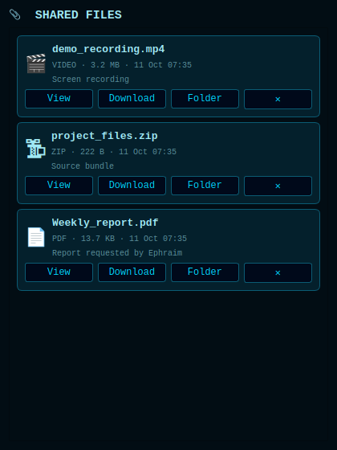
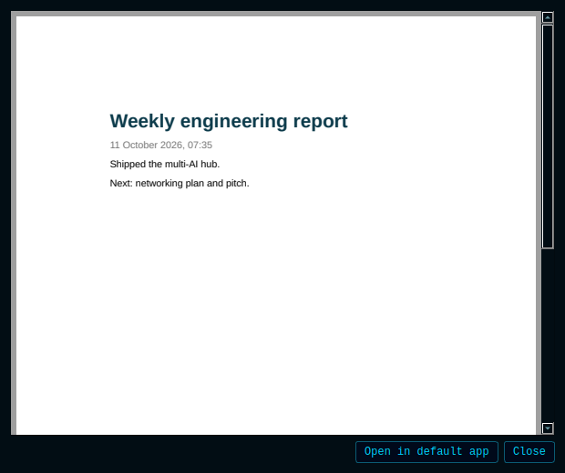
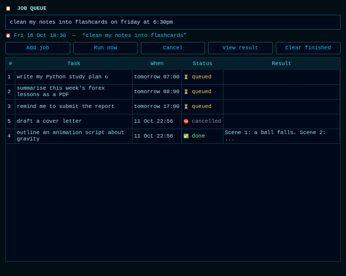

# Ephraim AI — Intelligence & Performance Upgrade

## What changed, in one paragraph
A new `core/ai/` package gives every AI call one front door: provider adapters
(Gemini, Anthropic, OpenAI-compatible — OpenAI, Groq, OpenRouter, LM Studio, any
URL you add — and Ollama), a router that picks the cheapest model that is good
enough, bounded failover, token budgets, caching, usage/cost tracking, and a
hub that can ask several AIs at once or let them discuss. Memory recall is
ranked and editable, learning is opt-in, and the avatar has a realistic face.
**Existing features are untouched**: the Gemini Live voice session, the Gemini
model ladder, the HUD, plugins, actions and computer control all run as before.

## Audit findings (what was found before anything was changed)
| # | Finding | Action |
|---|---|---|
| 1 | `core/llm_client.py` (Ollama/OpenAI-local) had **no callers** — dead code | Superseded by adapters; file kept, Ollama auto-start reused |
| 2 | 29 call sites go through `core.gemini.call`; when every Gemini rung failed the feature simply failed | Optional cross-provider fallback added inside `gemini.call` |
| 3 | No usage/latency/cost record anywhere | `logs/ai_usage.jsonl` + summary |
| 4 | Memory recall = substring score; "my sisters" missed "sister name"; filler words ("my") matched everything | BM25 + stemming + prefix + recency (see benchmark) |
| 5 | Same fact under two keys became two drifting entries; corrections overwrote silently | De-duplication; corrections keep history |
| 6 | `open_app` ran model-supplied names through `shell=True` on Windows (command injection) | **Fixed**; 10 tests |
| 7 | API key in plaintext `config/api_keys.json` | Gitignored already; other providers' keys go to OS keyring / env, never to config |
| 8 | `actions/desktop.py` executes model-written code in a restricted namespace; `dev_agent.py` runs shell commands | **Not changed** — flagged, see "Open items" |
| 9 | System prompt (≈2.3k tokens) | Audited: already lean, no duplication worth removing; left alone |

## Using several AIs
Settings drawer → **🤖 AI PROVIDERS**, or `python -m core.ai status`.
1. Select a provider → **Set key…** (hidden input; stored in the OS keyring, else `config/secrets.json`; or set `GROQ_API_KEY` etc. in the environment).
2. Tick **On**, set **Priority** (lower runs first), edit **Models** as `id:tier` (0 light, 1 standard, 2 strong), press **Fetch models** to see what the provider really offers, **Test**, **Save**.
3. **Add provider…** takes any OpenAI-compatible base URL — that is how you integrate anything of your choice.

Voice examples (the `multi_ai` tool): *"ask Claude and Groq what they think of X"* (compare) · *"have them discuss whether…"* (discuss) · *"draft it with Gemini and have Claude review it"* (chain) · *"which AIs are available?"* (status).
Named agents with roles go in `config/providers.json` → `"agents"` (see `providers.example.json`).

**Safety of AI-to-AI talk.** Discussions are text-only: no participant gets tools, so none can make another act on the computer. Each AI receives the others' words quoted as untrusted data, rounds are capped (≤6) and a total token budget ends the talk early; everyone saying `AGREED:` ends it sooner.

## Routing rules
* Capabilities are filtered first (vision / tools / JSON / audio) — a model lacking one is never tried.
* Tier is estimated free of charge from the task hint, length, code, reasoning keywords and images. Simple → light; code → standard; hard reasoning/planning → strong.
* Among adequate models: `strategy=cost` (default) cheapest first (local = free), `priority` your order, `speed` measured latency.
* Failure handling: rate-limit → switch provider immediately (cooldown from `Retry-After`); timeout/outage → one jittered retry then switch; auth/not-found → 6 h cooldown; bad request → no cooldown. Hard bounds: `max_attempts` (4) and `deadline_s` (45). A weaker model is used only if nothing adequate exists, or if you enable `allow_downgrade`.
* `mode=manual` pins a model; fallback still applies unless you disable it.
* `monthly_cost_cap_usd` restricts routing to free/local models once reached.

## Token & cost controls
Input/output budgets per request · history trimmed to budget with older turns summarised (model-free extractive fallback) · duplicate tool outputs collapsed · long tool results compacted · only relevant tool definitions sent when >12 offered · only relevant memories sent (`memory.relevant_context`) and only to providers you marked **Memory** · cache for repeatable tasks (classify/extract/summarize/translate/rewrite) invalidated whenever memory changes · Anthropic prompt caching for long stable system prompts · actual token counts used whenever the provider reports them, estimates flagged `est`.

## Memory
Ranked recall, de-duplication, corrections keep up to 5 earlier values (`history_of`), `edit_entry`/`delete_entry`. **Learning is opt-in per item:** preferences you state are queued in `memory/pending.json`; say *"review what you learned"* (tool `memory_review`) to approve, reject, edit or delete. Nothing is stored on the strength of an overheard sentence. *This is a notebook, not training: no model's weights ever change.*

## Face
**⚙ CONTROLS → 🧑 FACE** toggles REALISTIC / HOLOGRAM (default realistic). Real eyes (sclera, iris with fibres, limbal ring, pupil, catchlights, lashes, lid crease, socket shadow) that keep looking at you as the head turns, brows, lips with teeth and tongue when speaking, hair, lit skin shaded per pixel. Lip-sync, gaze, blink and status behaviour are shared with the hologram. Skin/eye colour: `avatar_skin` / `avatar_eye` (hex) in `config/api_keys.json`.

## Security
Keys: env → OS keyring → `config/secrets.json` (0600, gitignored); never in `providers.json`, logs, prompts or the dashboard. Every error string passes through `redact()`. Provider replies are size-bounded, control characters stripped, and any tool call the model invented (not offered) is dropped. Private context is sent only to providers with **Memory** on. `open_app` no longer uses a shell.

## Migration & rollback
First run creates `config/providers.json` from `api_keys.json` (Gemini key honoured; old `llm_*` settings become an Ollama/LM Studio provider). `api_keys.json` is never rewritten by this code. **Rollback:** delete `config/providers.json`; to remove the layer entirely revert the commit — nothing else depends on it.

## Tests, evals, benchmarks
```
pip install -r requirements-dev.txt
python -m pytest tests -q          # offline, mocked, no cost
python -m evals.run                # regression eval (mock);  --live uses your providers
python bench/benchmark.py --baseline /path/to/original/checkout
```

## Open items / honest limits
* **No real provider was called** (no keys were available): adapters are verified against mocked wire formats, not live servers. First live run: `python -m core.ai test`.
* The **Gemini Live voice conversation itself stays Gemini-only** — it is native audio streaming and no other provider offers the same session. Other AIs join through tools (`multi_ai`) and as automatic fallback for the 29 side calls.
* Default model ids/prices are starting points; vendors rename and reprice. Use **Fetch models** and edit.
* Windows-specific paths (`os.startfile`) and the avatar were tested on Linux/offscreen only.
* `desktop.py` code execution and `dev_agent.py` shell use remain; they warrant a confirmation prompt (`core/confirm.py` exists) — recommended next step.
* Realistic face: frame cost ≈16 ms at HUD size vs ≈8 ms for the hologram; switch to hologram on slow machines.

## Career agent (`career_agent` tool)
* **coach** — looks through the camera or the screen and says what matters for connecting and the single best next action. Frames go only to local or *Memory*-trusted providers. It never identifies a stranger from their face.
* **draft** / **plan** — writes one outreach message, or a two-week networking plan. Nothing is sent.
* **send** — hands a drafted message to `send_message`, but only after you confirm on the HUD (`core/confirm`). Named agents with roles (networker, mentor, editor) can be added under `"agents"` and used with `multi_ai`.
* Typing into Word etc. uses the existing `computer_control` tool and zip handling uses `file_controller`. **Not built:** sending PDF/photo/zip attachments through chat apps — it needs fragile UI automation I could not test here.

## Facial reactions
`HoloAvatar.react(name)` eases into happy / laugh / surprised / thinking / concerned / curious / serious / agree and back (smile, brows, eye widening, jaw, **head turn**, gaze), and `react_to_text` picks one from what the assistant just said (wired in `main.py`). Listening and thinking states show curious and thinking automatically.

## What was deliberately not built
A "no rules / uncensored" mode. The assistant keeps its safety behaviour; it can still be blunt, candid and direct, which is configurable in `core/prompt.txt`.

## Reports and images
* [Test & benchmark report](TEST_REPORT.md)
* Face before: `images/face_before.png` · after: `images/face_after.png` · states: `images/face_after_states.png` · expressions: `images/face_expressions.png`


## Startup flicker (thinking ⇄ sleeping)
That pattern is the connect-retry loop: connecting shows THINKING, a failed attempt falls to SLEEPING, then it retries. Two fixes: the new tools no longer declare the Live-only `behavior` field (no existing tool uses it, and a server that rejects it fails every connect), and any connection failure now prints its reason in the log (`ERR: Could not connect — …`) and backs off 3→6→12→24→30 s instead of retrying every 3 s silently. If you still see it, the log line now says why (bad/missing key, VPN/network, quota).

## "Can't find my API key / lost network / use a VPN"
Three real faults, now fixed: (1) a key pasted with a trailing newline, space or quote was saved as-is and Google rejected it — keys are now cleaned on save and on read; (2) the key lookup cached an *empty* result, so a key pasted after launch was ignored until restart; (3) the setup screen overwrote `config/api_keys.json` with only the key, erasing camera, face-style and other settings — it now merges. Every connect failure now runs `core/ai/doctor.py`, which says which of these it is: no key, malformed key, rejected key, no DNS, blocked region, HTTPS interception, network blocked, quota, or "key and internet fine — the live websocket is blocked". Run it by hand with `python -m core.ai doctor`.

## HTTP 404 when adding another AI
Two causes, both handled. **Wrong base URL path** (`https://api.groq.com` without `/openai/v1`, a URL ending in `/chat/completions`, Anthropic's with an extra `/v1`): base URLs are now repaired automatically and a 404 says which path was tried. **A model name the provider does not offer**: Settings → AI providers → select it → **Auto-fix models** (or `python -m core.ai fix groq`) asks the provider what it serves and rewrites the list.

## Desktop pet and shortcut
`python -m core.shortcut` (or **⚙ CONTROLS → 🖥 CREATE DESKTOP SHORTCUT**) puts "Ephraim AI" on your desktop. Opening it starts the assistant with an animated animal (cat, dog, fox or panda — right-click to switch) that walks along the bottom of your screen, sits, naps and jumps, follows your cursor with its eyes, can be dragged, and talks with a speech bubble and moving mouth whenever the assistant speaks. `--pet-only` minimises the main window. **🐾 DESKTOP PET** toggles it. Also fixed: the face's reaction to speech was wired to an attribute that does not exist on the UI wrapper, so it silently never fired; it now goes through a thread-safe signal.

## Reports, photos, video, zip, video calls (`report_sender`)
`make_pdf` renders a report (text + images) with Qt's own PDF writer. `send` delivers PDF/photo/video/zip (up to 10 files, 45 MB) by **Telegram** (`sendDocument/Photo/Video`) or **e-mail** (SMTP attachments) — only files you name, and always after your on-screen CONFIRM. One-time setup: Telegram bot token via `python -m core.ai key telegram` plus `telegram_chat_id` in `config/api_keys.json`; e-mail via `smtp_host`, `smtp_user` and `python -m core.ai key smtp`. `call` opens a fresh Jitsi Meet room and sends you the link so you can join from your phone. **The assistant cannot join a call as a participant**; it talks with you in the app through the camera view.

## Self-improvement (`self_improve`)
Tell it what to change, or upload a code file to integrate. A strong model writes the change; it is validated (syntax, size, allowed files, no shell/eval/secret access, no removed safety checks), then **tested in a throwaway copy**. Your files are untouched until you confirm on screen; originals are backed up, the change is committed on its own `self/<id>` branch (never pushed) and `rollback` undoes it. The confirmation gate, secret handling, this module and the entry point are protected. **There is no unattended auto-apply, by design:** this program can control your computer, so changes to its own code need a human yes. The checks are a safety net, not proof — read the diff. It improves the code, not the model's weights.

## FILES panel — reports, videos and zips right in the app
Anything the assistant produces for you appears as a card in a **📎 FILES** window (button in ⚙ CONTROLS; it also opens by itself when a file arrives, and the chat gets a line like `📎 Weekly_report.pdf is ready — view or download it in the FILES panel`). Each card has **View** (in-app preview: PDF pages, images, video with sound, zip contents, text), **Download** (Save-as, starts in your Downloads), **Folder** and **✕** (removes the card, keeps the file). Files are kept in `Documents/Ephraim Reports/Shared`, so they survive the original being moved, and the list is remembered between sessions. Tell the assistant "make a PDF report of…" (`make_pdf`) or "show me that file" (`report_sender` mode `share`). Credential-looking files (`secrets`, `api_keys`, `.env`, tokens, keys, anything in `config/` or `.ssh/`) are refused. Sending to your phone or e-mail is still the separate `send` mode, with its on-screen confirmation.

 

## Coding coach (`coding_coach`) — learn to code, and get help with your code
**An 11-lesson Python course with checked exercises:** variables, strings, numbers, decisions, loops, lists, dictionaries, functions, error handling, FizzBuzz, Fibonacci. Say *"teach me to code"*: the assistant explains the idea with a small example, creates a starter file in `Documents/Ephraim Code` (opened in your editor; never overwritten once you start), you write the function, then say *"check my code"* — it runs your file against tests and names the exact failing case (`area(3, 4) should give 12 but gave 7`). *"Hint"* gives three escalating steps. Progress is remembered (*"how am I doing?"*). Every lesson's reference solution is tested to pass and every starter to fail, so the course itself is verified.
**Help with your own code:** *explain* (plain language), *debug* (give it the error), *review* (mentor-style tips) on a file or pasted code. API keys inside the code are scrubbed before anything is sent to a model, and the code is treated as untrusted text. **Run** executes a file only after your on-screen confirm.
**Isolation:** your code runs in a separate Python process (`-I`), in an empty temp folder, with a time limit, no inherited environment variables, and memory/CPU limits on Linux/macOS. That limits accidents; it is not a security sandbox, so only run code you trust. To have code written *for* you, the existing `code_helper` tool does that; this one teaches you to write it.

## Job queue — assign tasks with a time, get a Telegram message
Open **⚙ CONTROLS → 📋 JOBS**, type a task with a time, press Enter. The line under the box shows how the time was understood before you add it. Or say it: *"every weekday at 7am write my Python study plan"*, *"remind me at 5pm to submit the report"*, *"summarise this week's forex lessons as a PDF tomorrow 8am"* (voice tool `job_queue`). Understood times: `now`, `in 2 hours`, `at 5pm`, `tomorrow 8am`, `tonight`, `on friday at 6:30pm`, `2026-10-20 14:00`, `every day / weekday / monday`, `every 30 minutes`. No time = run right away. Every job reports to your Telegram when **queued**, **done** (with the result, and a PDF attached if long) and **failed**.
**What a job can do:** write something with an AI (optionally as a PDF), remind you, or cut a video clip with ffmpeg (`clip`). Transient failures retry up to 3 times, 5 minutes apart; bad input fails at once. A job that was due while the computer was off runs when the app next starts and says so; a repeating job queues **one** next run, never a pile of catch-ups. Phone-assigned and app-assigned jobs share one queue (`memory/jobs.db`).
**Not built, on purpose:** automated **trading** (placing orders with real money is not something to hand to an unattended script; a job can still write market-education notes or review a trading journal you give it, but it has no live prices or news — it has no internet access and says so), **attending online meetings**, **generating AI videos and uploading to YouTube/TikTok** (needs video-generation and platform OAuth integrations that I could not build or test here), and **operating your desktop**. Those would be separate projects.
### Running while your laptop is OFF
A laptop that is off runs nothing, so the same queue runs as a **headless worker on a machine that stays on** (spare PC, Raspberry Pi, a small always-on cloud VM):
```
python -m core.worker --telegram     # runs due jobs AND accepts tasks you message to your Telegram bot
python -m core.worker --once         # run what is due, then exit (for cron)
```
Message your bot from your phone: `write a study plan for Python tomorrow 7am` → `📋 Queued #4`. Also `/jobs`, `/result 4`, `/cancel 4`, `/run 4`. **Only your own chat id is obeyed**; anyone else messaging the bot is ignored. The worker needs the same `config/` (AI provider keys, Telegram token and `telegram_chat_id`; see `report_sender` setup). Example `systemd` unit:
```
[Unit]
Description=Ephraim job worker
After=network-online.target
[Service]
WorkingDirectory=/home/pi/My-Project
ExecStart=/usr/bin/python3 -m core.worker --telegram
Restart=always
[Install]
WantedBy=multi-user.target
```


## Fixes in this round
* **Provider failover:** when one provider was down, its extra models used up the retry budget before the next provider got a turn. A dead host or bad key now skips that provider's other models at once (found by the new end-to-end HTTP tests, 17 of them against local OpenAI-, Anthropic- and Ollama-style servers).
* **Phone uploads were invisible to the assistant:** the server saved the file and told the phone's web page, but nothing told the desktop app. An upload now loads exactly like a desktop drop (the assistant is told, it becomes the current file, and it appears in FILES). Tested through the real FastAPI route.
* **Desktop pet never appeared:** it only started if it had been explicitly switched on, so a fresh install never showed it. It is now on by default (turn it off with 🐾 DESKTOP PET) and any startup failure is shown in the chat.
* **Headless PDF crash:** creating a PDF with no Qt application object aborts the process; the worker would have died on its first report. Fixed and regression-tested.

# Final round

## AI providers: "I added my key but it still does not respond / is absent"
Three real causes, reproduced and fixed: (1) **a key did not switch its provider on** (every provider starts off; the key alone was ignored) — adding a key by any route now enables it, and a provider you switch off yourself stays off; (2) **one wrong key locked the provider out for 6 hours**, even after pasting the right one — cooldowns now clear the moment a key, URL or model list changes (and last 15 min otherwise); (3) **a key pasted with a space, quotes, a newline or `Bearer `** was rejected as invalid — keys are cleaned everywhere. Also new: `python -m core.ai check [provider]` (and **Test all** in Settings) sends one real request to each AI and explains the result in plain words — key rejected, quota used up, model not offered (repaired automatically), cannot reach the server, wrong URL, no key yet, switched off. Setting a key now tests it straight away. `multi_ai` says *why* an AI did not answer.

## Speech breaking up mid-sentence
Measured first: the realistic face does **not** starve the audio thread (worst wake-up delay under 2 ms in `bench/audio_jitter.py`). The real weakness was in the player: it wrote each piece of audio to the speaker the instant it arrived, with no jitter buffer, so on a choppy link (mobile data, VPN, weak Wi-Fi) a gap longer than the queued audio left the speaker dry. `core/audio_buffer.py` is an **adaptive jitter buffer**: it starts at 100 ms (no noticeable delay on a good connection), grows when the speaker actually runs dry, and shrinks after a clean stretch; the log says when it adds buffering. In a simulation, on a choppy connection it cut breaks from about 2.1 per reply to about 0.01 once it had learned, at a cost of ~40 ms on a good link. Very bad links (stalls over a second) still break. The numbers are simulated, not measured on your network; breaks are logged (`🔊 Speaker ran dry mid-speech — buffer 340 ms, 2 break(s)`) so you can see real behaviour. Tune with `audio_buffer_ms` / `audio_buffer_max_ms` in `config/api_keys.json`.

## Code preview inside the app (no VS Code)
Anything the assistant writes opens in its own **CODE PREVIEW** window: syntax-highlighted code with line numbers; **HTML renders as a website** (full browser engine if `PyQt6-WebEngine` is installed, otherwise Qt's basic HTML view plus *Open in browser*); Markdown renders as formatted text; self-improvement proposals show as a coloured diff. It **follows the file while the assistant is still writing or fixing it**. Wired into `code_helper`, `dev_agent` (project files), the coding coach (lessons), `self_improve` (diffs), the FILES panel (View on any code/HTML/Markdown file) and a new `show_code` tool. VS Code is opt-in only (`"code_external_editor": true`), and the old `shell=True` launch in `dev_agent` (a command-injection path through the project name) is gone.

## Integrations — connect anything
`config/integrations.json` (or by voice, with confirmation): a base URL, how to authenticate, named actions. **Built in, free, no key:** weather + geocoding (Open-Meteo), Wikipedia, currency rates (Frankfurter/ECB), crypto prices (CoinGecko), dictionary, Hacker News, NASA picture of the day, country facts, Open Library. **Templates for your own URL/key:** Slack, Discord, any webhook (IFTTT, Zapier, Make, n8n). `python -m core.integrations list | call | key | test`. Reads are automatic; **anything that posts (POST/PUT/PATCH/DELETE) needs your approval**; addresses on your own network (localhost, 192.168.x, cloud metadata) are blocked, including via redirects, unless an integration is marked `local`; keys live in the keyring/env, never in the JSON or in replies. Jobs can use integrations too. *The built-in endpoints are written from the services' public documentation and could not be called from where this was built: run `python -m core.integrations test` once to check each one from your machine.*

## Approvals and reminders on Telegram
Reminders arrive with **✅ Done / 💤 10 min / 💤 1 hour** buttons. A job ending "…and ask me to approve it" sends its result with **✅ Approve / ❌ Reject** and does nothing further until you tap. The on-screen confirmation gate is **also offered on your phone** (answer within its 90 s window; whichever answers first wins). Safeguards: only your chat id is obeyed; each request has its own random id and expires (24 h by default); a request can be decided once; after approval only **named, allow-listed actions** can run (never anything the model wrote). When the headless worker runs it owns Telegram; otherwise the desktop app does (two programs cannot poll one bot).

## System doctor (`system_doctor`)
*"Run a system check."* Diagnoses disk, memory, CPU, internet (DNS vs blocked), Gemini key, missing Python packages, audio devices, corrupt config, failing AI providers (from the usage log) and failed/stuck jobs, worst first, with plain explanations. *"Fix it."* runs only named repairs — `install_missing`, `clear_cache` (caches and old logs only; never your files, reports or memory), `reset_ai`, `repair_config`, `recover_jobs`, `flush_dns` — each shown to you and confirmed first.

## AI videos (`ai_video`, or "make a 60 second video about…" in the job queue)
Script by your AI provider → pictures from Pollinations (free, no key) → voice from edge-tts (free) → MP4 by ffmpeg (bundled via `imageio-ffmpeg`), with captions burned in. Each free service has a fallback (local title cards if image generation is unreachable; captions-only if no voice works) and the result says which fallback it used. It runs as a background job, appears in FILES and on your Telegram, and can ask for your approval before you publish. **Not a text-to-video model**, and **nothing is uploaded to YouTube/TikTok** (that needs platform OAuth setup I could not build or test).

## Verification
`python -m pytest tests` (offline). New this round: real-HTTP tests of OpenAI/Anthropic/Ollama-style servers, the real FastAPI phone-upload route, a real ffmpeg render, and simulated networks for the jitter buffer. Not verified: any live provider, Telegram, Pollinations, edge-tts or Windows-specific behaviour — those need your keys and machine.
